# Flesh That Hates and Biomancy in the Visceral Heap: overlap and integration report

Written 2026-11-25; investigation only, nothing built. Jar: `FleshThatHates-forge-1.19.2-1.0.1.jar` (copy in
`DecompiledMods/`, unpacked and decompiled beside it; also in the launcher's downloads folder, not in `mods/`). Forge
1.19.2, MCreator, license Academic Free License 3.0: the jar stays untouched, and every change is our own code written
from its behavior (mixins and data in our jars, as with Biomes O' Plenty for the Visceral Heap). No port needed. Short
name in this file: **FTH**. Test prefix `FTH-` (used for both mods). Biomancy 2 (2.3.2.0) is the second mod in this
report, in section 10 with its own decisions B1 to B12; sections 0 to 8 are FTH.

Goal (owner, 2026-11-25): FTH content, and Biomancy's blocks and mobs (section 10), appear only in the Visceral Heap (Biomes O' Plenty `biomesoplenty:visceral_heap`,
the "flesh heap", [visceral_heap.md](visceral_heap.md)), with no spreading mechanics.

Scope rule: integration adds no recipe or mechanic that is not in the mod or defined by a pack rule unless the owner
asks by name; upstream bugs are fixed.

## 0. At a glance

<!-- generated:status_index begin open_work sha1=b0a3bc04f97a -->
**Open work** (generated from `todo/rows/*.csv` by `tools/status_index.py`; change a row with `tools/todo.py`). Status: 1 open TODO row (Planned 1), 0 Complete.

| Id | Status | Tests | Change |
|---|---|---|---|
| `mod-integration #30` | Planned | S C P | Flesh That Hates (1.0.1) and Biomancy 2 (2.3.2.0): blocks and mobs in the Visceral Heap only, no spreading |
<!-- generated:status_index end open_work -->

| Part | Where | Status |
|---|---|---|
| Inventory: 55 items (39 block items, 2 foods, 13 spawn eggs, 1 detector), 39 blocks, 14 entities, 3 effects, 1 potion, 30 recipes, 25 tags, 1 biome modifier, 44 sound events, 2 game rules | section 1, 3 | read |
| Spread paths: 7 (block ticks, rot and regrowth, incubator and Snatcher block conversion, kill conversion, infected death, incubator hatching) | section 3.2 | mapped from the code |
| Upstream bugs B1 to B6 | section 3.6 | found in code; B1 needs a log check after install |
| Overlap: BOP Heap blocks, rotten flesh, Prepared Flesh, tooth blocks, vanilla wood | section 2 | 9 rows |
| Fold-in | section 4 | 15 steps |
| Decisions | section 5 | D1 to D16 open |
| Tests | section 8 | FTH-01 to FTH-16 drafted |

- Jar: MCreator 2022-era code, 189 classes, 100 procedure classes; the 20 largest block procedures did not
  decompile (Vineflower), read from bytecode.
- License: AFL 3.0 (`mods.toml`). Route as for other non-GPL jars: untouched jar, our mixins and data in our own jars.
  Entity names and the theme come from SCP-610 of the SCP Wiki (CC BY-SA 3.0): credit line on the project page (D12).
- Dependencies: Minecraft 1.19.2, Forge 43+, GeckoLib (marked optional, but every mob uses GeckoLib models;
  `geckolib-forge-1.19-3.1.40` is in `mods/`). `mods.toml` says version **1.0.0** while the file says 1.0.1 (B5).
- Pack references to `flesh_that_hates`: none. Heap context: [visceral_heap.md](visceral_heap.md),
  [plan_visceral_heap.md](plan_visceral_heap.md), [plan_flesh_recipes.md](plan_flesh_recipes.md); corpse skeletons in
  the Heap: [plan_corpses.md](plan_corpses.md) item 23.
- Dumps: `kubejs/exported/display_names.json` is from 2026-10-20, before BOP was added; `/dumpall` is step 0.

## 1. Overview

FTH is an infection mod. Nothing generates in the world: the only natural entry is the **Infected Pillager**, which
spawns in the Overworld from day 3 at night or in darkness. Its victims turn into SCP-610 mobs; SCP-610-1 deaths can
hatch **Incubators** (SCP-610-6, immobile, small and big), and incubators are the engine of the infection. They:

- convert the block under them to flesh, and spawn mob packs on flesh blocks nearby (through the invisible
  SCP-610 Spawner entity);
- keep flesh alive: a living flesh block with no incubator within 70 blocks (small) or 210 (big) turns into its
  rotting variant at 10 % per check, and a rotting block with none in range breaks at 10 % per check; with an
  incubator in range rotting blocks grow back to living ones (3 %) and living ones spread into neighbors.

Each block "check" is a scheduled tick every 1 to 1.5 seconds (every 0.1 s for the rotting tooth bush), not a random
tick. Spread targets come from 16 `flesh_that_hates:infectable_*` block tags (vanilla grass, dirt, sand, gravel,
concrete powder, logs, leaves, planks and the full vanilla wood set, plus air for veins and roots).

Players: hits from SCP mobs give **Flesh Infection** (lower chance above 12 armor; shields checked), as do
eating raw Flesh (70 %) and walking through tooth bushes (70 % per prick). The effect is permanent, rises through four stages (damage, Weakness, Slowness, screen
overlays, strips buffs from mobs), is cured by milk, and turns the carrier into an SCP-610-1 on death. **Call of the
Hive** draws SCP mobs within 40 blocks to the player. **Shake** is the big incubator's screen shake.

### Facts

| Field | Value |
|---|---|
| Mod id | `flesh_that_hates` (package `net.mcreator.fleshthathates`) |
| Items | 55: `flesh` (food 1 / 0.1, meat, 70 % Flesh Infection on eating), `cooked_flesh` (6 / 0.4, meat), `flesh_detector` (stack 1, 10 s cooldown, finds SCP mobs within 150 blocks), 13 spawn eggs, 39 block items |
| Blocks | 39: living set `flesh_` block, dirt, sand, log, wood, leaves, grass, roots, veins, veins_default, planks, stair, slab, door, trapdoor, fence, gate, button, pressure_plate, plus `tooth_bush` (20); rotting set, same minus veins_default (19) |
| Entities | 14: `infected_pillager`, `scp_6101` (Infected Humanoid, 20 hp), `scp_6102` (Infected Animal, 20), `scp_6103` (Pincher, 15), `scp_6104` (Bulwark, 70 hp, 13 armor), `scp_6105` (Snatcher, immobile, 15), `small_scp_6106` / `big_scp_6106` (Incubators, immobile, 40 / 100 hp), `scp_6107` (Drifter, 20), `scp_6108` (Herpad, 50), `scp_6109` (Scuttler, 30), `scp_61010` (Cradle, 30), `scp_61011` (Stretcher, 40), `scp_610_spawner` (invisible, removes itself after 3 s) |
| Effects | `flesh_infection` (harmful, 4 stages by amplifier), `call_of_the_hive` (harmful), `shake` (neutral) |
| Potions | `flesh_infection_potion` (Flesh Infection 60 min); brewing: Awkward + any item in `#flesh_that_hates:flesh_infected` (40 items: all FTH blocks and raw Flesh) |
| Recipes | 30: 27 `crafting_shaped` (wood sets 20, detector 1, campfire 2, soul campfire 2, smoker 2), `campfire_cooking` 1, `smelting` 1, `smoking` 1; the 6 campfire and smoker recipes are broken (B1) |
| Loot | no loot tables; block drops come from `getDrops` (drops itself), mob drops from death procedures (Flesh at 70 %, twice) |
| Tags | 16 `infectable_*` block tags, `valid_flesh_mob_spawn` (blocks), `flesh_mob`, `call_of_hive_attraction` (entity types), `flesh_infected` (items); vanilla `climbable`, `fences`, `wooden_fences`, `leaves`, `logs` (blocks), `planks` (items), `mineable/axe`, `hoe`, `shovel` |
| Worldgen | none except `infected_pillager_biome_modifier.json`: `forge:add_spawns`, `forge:any` biome, weight 15 |
| Game rules | `enableFleshGrow` (true; gates block spread, rot and regrowth, incubator and Snatcher block conversion), `disableCallOfTheHive` (false) |
| Advancements | none shipped (the pack drops all advancements anyway); death procedures grant `adventure/kill_a_mob` |
| Lang | en_us only, 128 keys; entity names are SCP designations with a nickname ("SCP-610-4 (Bulwark)") |
| Sounds / textures | 44 sound events (55 ogg); 28 block, 12 item, 18 entity textures, 3 screen overlays, 14 GeckoLib geo and animation files |
| Config | none (game rules only) |

## 2. Overlap

| Thing | Overlaps with | Problem | Proposal |
|---|---|---|---|
| `flesh_block`, `flesh_dirt`, `flesh_sand` | BOP `flesh` and `porous_flesh` (the Heap's ground, crushed and cultivated by [plan_flesh_recipes.md](plan_flesh_recipes.md)) | Two flesh ground blocks with different looks, drops and uses in the same biome | *overlaps w/ BOP flesh* D4: BOP flesh stays the ground; FTH ground blocks only under FTH trees |
| `flesh_roots` (climbable) | BOP `flesh_tendons` / `flesh_tendons_strand` (climbable since 2026-11-10) | Two climbable flesh strands | *overlaps w/ BOP tendons* keep both: roots grow up from the floor, tendons hang |
| `flesh_veins` | `minecraft:sculk_vein` shape | Look only | none |
| `tooth_bush` | Upgrade Aquatic tooth blocks, Alex's Abnormalities tooth sets | Name only; a plant, not a building block | none |
| `flesh` (item) | `minecraft:rotten_flesh`, `jrftl:prepared_flesh`, `creativeengineering:prepared_flesh_block`, Canned Tough Jerky (`canned_goods:canned_rotten_flesh`) | Another flesh food; raw form infects | *overlaps w/ rotten flesh* D13: keep distinct (mob drop with its own effect), meat food type |
| `cooked_flesh` | cooked meats (6 / 0.4 is below cooked porkchop 8 / 0.8 and cooked chicken 6 / 0.6) | Values off the pack's meat curve | *overlaps w/ cooked meats* D13: values through [food.md](food.md) |
| Flesh wood set (2 sets of 12) | vanilla and modded woods, [recipes_wood.md](recipes_wood.md) | Planks are in `#minecraft:planks`, logs only in the block tag `#minecraft:logs`, not the item tags (no charcoal, no vanilla campfire) | *overlaps w/ wood rules* step 6 |
| Heap mobs | the Heap's spawn list (Ghast 50, Zombified Piglin 100, Bone Serpent, Crimson Mosquito, Farseer, Strider, Laviathan; `kubejs/exported/spawns.json`) | Zombified piglins are on FTH's conversion list: an SCP kill turns them into SCP mobs | *overlaps w/ Heap spawns* D6, D7 |
| Bone corpses | [plan_corpses.md](plan_corpses.md) item 23 (Heap skeletons, open Q21) | Both decorate the Heap; no clash | cross-link only |

Batch: no other mod is being integrated with it. No other installed mod adds an infection or spread mechanic.

## 3. New content

### 3.1 Blocks

| Set | Blocks | Tick behavior | Survives on |
|---|---|---|---|
| Living ground | flesh_block, flesh_dirt, flesh_sand | spread into neighbors (0.2 % per target, leaves 7 %, logs 1 to 3 %), rot without an incubator, burn next to fire | any |
| Living plants | flesh_grass, tooth_bush (pricks: 6 % per tick inside it, 1 damage and Flesh Infection at 70 %), flesh_roots (climbable, grows up to 6 high), flesh_veins, flesh_veins_default | as above; veins also sprout grass (20 %), tooth bushes (4 %) and root columns | a non-air, non-liquid block below |
| Living wood | log (axis), wood, leaves (plain `Block`, no decay), planks, stair, slab, door, trapdoor, fence, gate, button, pressure_plate | as above | any |
| Rotting | the same 19 minus veins_default | regrow to living with an incubator in range (3 %), break without one (10 %), turn to fire next to fire (1 %); the rotting tooth bush pricks and infects like the living one | as living |

**Textures.** 28 block textures, all 16 x 16, no animation; every living texture has a rotting twin (the rotting one
is browner and duller). The sheet shows the upstream files at 4x (doc image only). Blocks to textures (from the
blockstates and models; the `rotting_` blocks use the same models with the `rotting_` texture):

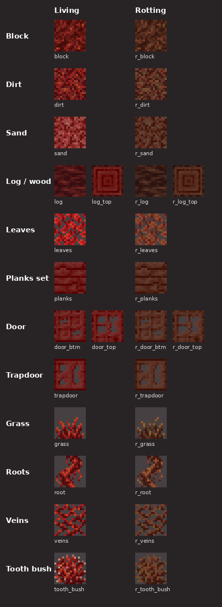

| Block (and its rotting twin) | Textures | Model |
|---|---|---|
| flesh_block | `flesh_block` | cube_all |
| flesh_dirt | `flesh_dirt` | cube_all |
| flesh_sand | `flesh_sand` | cube_all |
| flesh_log | `flesh_log` (side), `flesh_log_top` | cube (axis) |
| flesh_wood | `flesh_log` on all six sides | cube_all |
| flesh_leaves | `flesh_leaves` | cube_all |
| flesh_planks, stair, slab, fence, gate, button, pressure_plate | `flesh_planks` | vanilla shapes |
| flesh_door | `flesh_door_bottom`, `flesh_door_top` (item icon `textures/items/flesh_door`) | vanilla door |
| flesh_trapdoor | `flesh_trapdoor` | vanilla orientable trapdoor |
| flesh_grass | `flesh_grass` (item icon `items/flesh_grass`) | cross |
| flesh_roots | `flesh_root` (item icon `items/flesh_root`) | cross |
| flesh_veins, flesh_veins_default | `flesh_veins` (both use it; no `rotting_flesh_veins_default`) | own flat model `flesh_veins` (rotting: `flesh_veins_rot`) |
| tooth_bush | `tooth_bush` (item icon `items/tooth_bush`) | cross |

Item textures: `flesh`, `cooked_flesh`, `flesh_detector` (animated, `.mcmeta`), plus the door, grass, root and tooth
bush icons of both sets. Any recolor would go through the owner's tools with a `texture_sources/sources.csv` row
([texture_sources.md](texture_sources.md)).

### 3.2 Spread paths (what "no spreading" has to stop)

| # | Path | Code | Gated by `enableFleshGrow` |
|---|---|---|---|
| S1 | Living block spreads into `infectable_*` neighbors | 20 `Flesh*UpdateTickProcedure` | yes |
| S2 | Living rots / rotting breaks / rotting regrows | the same plus 19 `RottingFlesh*UpdateTickProcedure` | yes |
| S3 | Incubator converts the block under it (0.04 % per tick) and spawns packs on flesh within 8 blocks (0.2 % small, 1 % big, none if an SCP mob is within 15 blocks) | `SmallSCP6106` / `BigSCP6106OnEntityTickUpdateProcedure` | conversion yes, pack spawns no (`doMobSpawning`) |
| S4 | Snatcher converts the block under it (0.08 % per tick) | `SCP6105OnEntityTickUpdateProcedure` | yes |
| S5 | An SCP mob or Infected Pillager kills a villager, player, animal, zombie, piglin, illager, Enderman, spider, Warden and others -> an SCP mob appears | `SCP6101`, `InfectedPillagerThisEntityKillsAnotherOneProcedure` | no |
| S6 | Any entity with Flesh Infection dies -> SCP-610-1 (players, humanoids) or SCP-610-2 (animals) | `MobDiesWithInfectionProcedure` (Forge `LivingDeathEvent`) | no |
| S7 | SCP-610-1 death hatches a small incubator (4 % near a player, 20 % when not killed by a player, never when burning) | `SCP6101EntityDiesProcedure` | no |

Flesh Infection itself (from hits, raw Flesh, the potion) is a personal effect; it only spreads through S6.

### 3.3 Mobs

Only the Infected Pillager has a spawn rule (`SpawnPlacements`, Overworld only, from day 3, night or light 0) and a
biome modifier. The other 13 types appear only from conversions (S5, S6), incubator packs (S3) and spawn eggs. Pack
composition from the SCP-610 Spawner: rolls between 0.2 and 0.7 for SCP-610-1, -3, -7, -9, -11 (most common), -8,
-10, -4, -5, -2. Big incubators give nearby SCP mobs Strength II. Small incubators become big only with a debug stick
(dev path). Mobs burn: fire damage kills incubators fast and blocks S7.

**Renders.** Offline previews made from each mob's GeckoLib model (`geo/*.geo.json`) and texture in the jar, in the
rest pose (no animation), seen from the front left. These are doc images only and are not used in the game.
Each picture is scaled to fit its frame; the lineup below shows true relative size, with the renderer scale
applied. SCP-610-1 and -2 pick one of their textures at spawn, and every variant is shown. The jar also ships
`scp-457.geo.json`, which no entity uses.

| Mob | Render | Model, texture, renderer scale | Hitbox (w x h), hp |
|---|---|---|---|
| Infected Pillager | 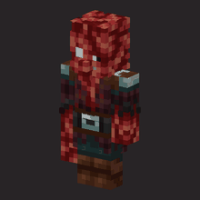 | `infected_pillager`, `infected_pillager`, 1.0 | 0.6 x 1.8, 20 |
| SCP-610-1 (Infected Humanoid) | 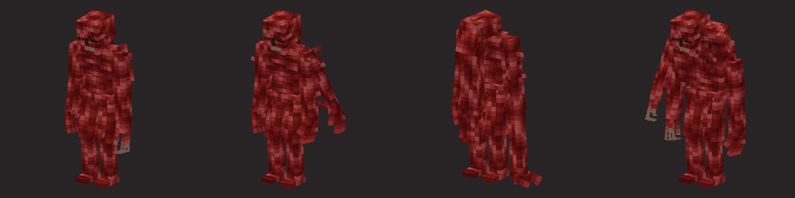 | `610-1`, `humanoid1` to `humanoid4`, 0.8 | 0.6 x 1.8, 20 |
| SCP-610-2 (Infected Animal) | 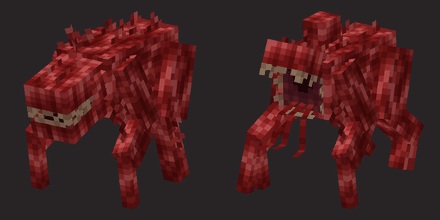 | `610-2`, `animal1`, `animal2`, 1.0 | 0.8 x 1.7, 20 |
| SCP-610-3 (Pincher) | 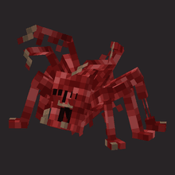 | `610-3`, `pincher`, 1.0 | 0.7 x 0.8, 15 |
| SCP-610-4 (Bulwark) | 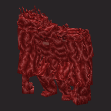 | `610-4`, `bulwark`, 1.0 | 1.6 x 4.1, 70 |
| SCP-610-5 (Snatcher) | 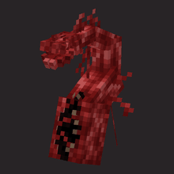 | `610-5`, `snatcher`, 1.0 | 0.7 x 1.8, 15 |
| SCP-610-6 (Small Incubator) | 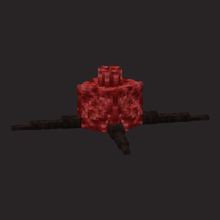 | `incubator_small`, `small_incubator`, 1.0 | 0.9 x 0.9, 40 |
| SCP-610-6 (Big Incubator) | 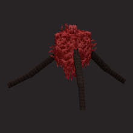 | `incubator_big`, `big_incubator`, 2.0 | 2.8 x 7.0, 100 |
| SCP-610-7 (Drifter) | 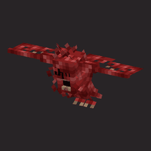 | `610-7`, `drifter`, 1.0 | 0.5 x 0.9, 20 |
| SCP-610-8 (Herpad) | 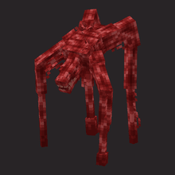 | `610-8`, `herpad`, 1.6 | 1.2 x 2.3, 50 |
| SCP-610-9 (Scuttler) | 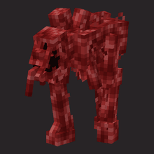 | `610-9`, `scuttler`, 1.5 | 0.8 x 1.8, 30 |
| SCP-610-10 (Cradle) | 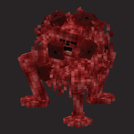 | `610-10`, `cradle`, 1.4 | 0.8 x 1.8, 30 |
| SCP-610-11 (Stretcher) | 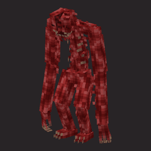 | `610-11`, `stretcher`, 1.0 | 0.8 x 3.0, 40 |
| SCP-610 Spawner | none (invisible, `invisible_texture`) | no model | 2.0 x 5.0, 1 |

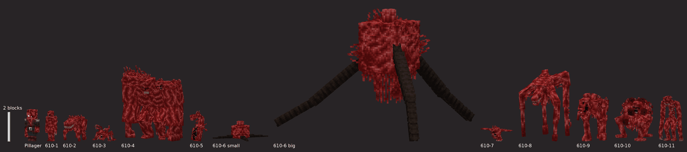

Some hitboxes are much shorter than the models (measured from the rest pose at renderer scale): Herpad 4.5 blocks
tall against a 2.3 hitbox, Scuttler 3.3 against 1.8, Cradle 2.9 against 1.8, Bulwark 5.0 against 4.1, Big Incubator 8.4
against 7.0. Their upper bodies cannot be hit. Upstream look, no fix proposed; FTH-16 checks it on the client.

### 3.4 Effects and potion

Flesh Infection stages (amplifier 0 to 3) rise at about 0.01 % per tick (about one stage per 8 minutes), with growing
armor-bypassing damage (1 per hit, rising chance), Weakness and Slowness at stage 2 and 3, and screen overlays 1 to 3.
On mobs it removes Saturation, Resistance, Absorption, Regeneration, Health Boost, Speed and Haste every tick. No
curative override, so milk cures it. Potion: 60 min, Awkward base, splash, lingering and arrow forms.

### 3.5 Recipes

Wood sets: log -> 4 planks, 4 logs -> 4 wood, slabs, stairs, doors, trapdoors, fences, gates, buttons, plates (vanilla
shapes, both sets). Flesh -> Cooked Flesh by smelting, smoking, campfire. Flesh Detector: 2 bones, flesh, compass,
2 iron ingots, redstone block. Campfire, soul campfire and smoker from flesh logs (broken, B1). Axe on a flesh or rotting log or wood
turns it into oak log or oak wood (1 durability): the "cure" for infected trees.

### 3.6 Upstream bugs

- **B1** `campfire_recipe`, `campfire_recipe_2`, `soul_campfire_recipe`, `soul_campfire_recipe_2` (pattern
  `"a","aba","ccc"`) and `smoker_recipe`, `smoker_recipe_2` (`"a","aba","a"`) have rows of different widths; vanilla rejects them ("each row must be the same width"). Confirm in
  `logs/latest.log` after install. Fix: remove; put flesh logs in the item tags so vanilla's own campfire recipe takes them (soul campfire and smoker
  too, as both use `#minecraft:logs`).
- **B2** Infected Pillager spawn condition scans a 9999-block box for incubators on every spawn attempt, and joins the
  "no big" and "no small" checks with OR (any world without both kinds passes). Its biome modifier adds it to every
  biome, Nether and End included, where the condition always fails.
- **B3** Every FTH block runs its procedure on a scheduled tick every 20 to 30 ticks (rotting tooth bush 2), and each
  run can scan up to five boxes of 120 to 420 blocks for incubators: cost grows with every flesh block loaded, even
  with spread off, unless the tick itself is stopped.
- **B4** Flesh logs and wood are in the block tag `#minecraft:logs` only, not the item tags `#minecraft:logs` /
  `#minecraft:logs_that_burn`: no charcoal, no fuel tag, no vanilla campfire.
- **B5** `mods.toml` version 1.0.0 in the 1.0.1 file: a mixin version gate must match `1.0.0`.
- **B6** Death message "%s turned into a SCP-610 Instance" (article and case).

## 4. Fold-in, in build order

Homes: containment, worldgen, spawns and tags in **Creative Worldgen** (worldgen and fauna; next to the Heap code,
`visceralheap/` and `packs/biomesoplenty/`); Flesh and Cooked Flesh food values and tooltips in **Creative Delight**
(memory `creative-delight-routing`); the effects and potion text in **Creative Common** (effects and potions are
Common's since 2026-11-06).

0. **Install and dumps** (skill `add-mod`): jar into `mods/`, `mod_sides.md` row (both sides: blocks, entities,
   GeckoLib models). Then `/dumpall` and `/cdevgen run all dumps`; the name dump predates BOP as well
   ([dumpall-refresh-workflow](agent_notes/dumpall-refresh-workflow.md)).
1. **Stop block ticks** (S1, S2, B3). Mixin package `mixin/fleshthathates/` in Creative Worldgen, gated in
   `WorldgenMixinPlugin` on `flesh_that_hates` version `1.0.0` exactly (B5). Cancel `onPlace` (the first
   `scheduleTick`) and `tick` on the 39 block classes; one mixin with a target list, as all declare the same methods.
   Blocks become static: no spread, no rot, no regrowth, no fire conversion (D3), no tick cost. The rotting tooth bush
   keeps `entityInside` (D2).
2. **Belt and braces for the rest of S1 to S4** through `global.tags` in a new
   `kubejs/data/creativeworldgen/kubejs/tags/flesh_that_hates.js`: empty all 16 `flesh_that_hates:infectable_*` block
   tags (`removeAll`), so incubators and Snatchers find no target; and force `enableFleshGrow` false at server start
   (Creative Worldgen, with the gate of step 1; D1).
3. **Mob spread S5 to S7** (D7): inject at the head of `MobDiesWithInfectionProcedure.execute`, the two
   `ThisEntityKillsAnotherOneProcedure.execute` and the incubator branch of `SCP6101EntityDiesProcedure`; allow only
   when the position is in `biomesoplenty:visceral_heap` (or never, per D7).
4. **Remove the Infected Pillager's spawn** (D9): override `data/flesh_that_hates/forge/biome_modifier/infected_pillager_biome_modifier.json`
   with `forge:none` in Creative Worldgen's pack data (fixes the B2 cost too).
5. **Heap worldgen** (D4): configured and placed features plus one `forge:add_features` biome modifier for
   `biomesoplenty:visceral_heap` only, in a pack folder of Creative Worldgen that is on only while both BOP and FTH
   load (as `packs/biomesoplenty/`). Floor placement over every Nether layer (count on every layer or an environment
   scan), `minecraft:biome` filter. Candidates: patches of flesh grass and tooth bushes on BOP flesh, veins, root
   columns, small flesh trees (log, leaves). Check that `minecraft:tree` accepts BOP flesh below the trunk (vanilla
   needs `#minecraft:dirt`; do not add BOP flesh to that tag); fall back to a small feature class in Creative Worldgen.
   Spill: SQ-VH-06c found Heap features 12 blocks into a neighbor; keep FTH features small. Generator:
   `tools/gen_visceral_heap.py` if the surface rule needs no change, else a new generator listed in
   `tools/generators.json`. [visceral_heap.md](visceral_heap.md) gains a parts row.
6. **Tags** ([recipes_wood.md](recipes_wood.md)): flesh and rotting logs and wood into the item tags `#minecraft:logs`
   and `#minecraft:logs_that_burn` (B4); BOP `flesh` and `porous_flesh` into `flesh_that_hates:valid_flesh_mob_spawn`
   (D5) so incubator packs spawn on the Heap's ground; BlockRunner surface tags for the FTH ground blocks (spongy as
   BOP flesh, [blockrunner.md](blockrunner.md)).
7. **Spawns** (D6, [mob_spawns.md](mob_spawns.md)): `forge:add_spawns` for the chosen SCP mobs, Heap only. Register
   spawn placements for them (Forge 1.19.2 `SpawnPlacementRegisterEvent`, `ON_GROUND`, monster rules); MCreator
   registered none. Refresh `tools/gen_spawn_table.py` -> [spawns_by_biome.md](spawns_by_biome.md).
8. **Ids in dicts**: `flesh`, `cooked_flesh`, `flesh_detector` in `item_dict.js`; the generated blocks in
   `block_dict.js`; Creative Common rebuild.
9. **Recipes** through `global.NCH`: remove the 6 broken recipes (B1); wood set rules of
   [recipes_wood.md](recipes_wood.md) for both sets (sawmill and cutting as other modded woods); pack cooking rules for
   Flesh ([recipes_cooking.md](recipes_cooking.md)); axe scraping per D11 (a mixin cancel on `PlayerScrapsLogsProcedure`
   if off).
10. **Food** (Creative Delight; [food.md](food.md), `food_types.json`): Flesh raw meat, Cooked Flesh cooked meat,
    values per D13; `tools/food_families.py --check`; stack sizes 64 kept ([stack_sizes.md](stack_sizes.md)); compost
    as other meats ([compost](agent_notes/compost-framework.md)); cans only if a meat can rule covers it
    ([cans.md](cans.md)).
11. **Effects and potion** (Creative Common; [effects.md](effects.md), [potions.md](potions.md),
    [potion_buckets.md](potion_buckets.md)): JEED text for the 3 effects, potion mixers, bucket and tipped arrow rows
    for Flesh Infection (D10).
12. **Loot** ([loot.md](loot.md)): mob drops are procedure item spawns (no Looting, invisible to loot modifiers).
    D16 decides whether to move them into entity loot tables.
13. **Names and lang** ([names.md](names.md)): B6, D12; our copy under `assets/flesh_that_hates/lang/` in Creative
    Worldgen (memory `forge-shared-asset-path`).
14. **Block, mob, UI audit**: mineable tags ship; Item Physic for flesh items and logs
    ([item_physics.md](item_physics.md)); WTHIT ([wthit_lines.md](wthit_lines.md)); JEI: hide the 13 spawn eggs per
    pack policy, the rotting set per D2 ([jei_coverage.md](jei_coverage.md)); tooltip for raw Flesh's infection chance
    ([tooltips.md](tooltips.md)). Textures are upstream copies: no `texture_sources/sources.csv` rows.
15. **Release**: changelog family `## Flesh That Hates` once built, TODO row, README row status, project page credits
    (AFL 3.0 notice, SCP Wiki CC BY-SA 3.0 credit; D12).

Order: 0 first; 1, 2 and 4 before any world with FTH loaded (a world without them starts spreading on the first
infected kill); 3 after D7; 5 and 7 after D4 to D6; 6 before 5's live check (incubators); 8 before 9 to 11; 13 and 15
last.

## 5. Decisions for the owner

| # | Question | Recommendation | Default if not answered |
|---|---|---|---|
| D1 | Block spread off everywhere, inside the Heap too (steps 1 and 2, `enableFleshGrow` forced false)? | Yes | Yes |
| D2 | Rotting set (19 blocks): rot is gone with the ticks, so it never appears. Generate some as dead patches in the Heap, or hide it? | Generate a minority share (about 1 in 5 patches and trees) so both sets are obtainable | Not generated, hidden from JEI |
| D3 | Flesh blocks turning to fire next to fire: drop with the ticks? | Drop (no vanilla flammability added, scope rule) | Drop |
| D4 | What generates in the Heap? | Grass, tooth bushes (they prick and infect: a real hazard on the Heap floor), veins, root columns, small trees with flesh dirt under the trunk; no FTH flesh block or sand (BOP flesh stays the ground) | Grass, tooth bushes, veins only |
| D5 | BOP flesh and porous flesh count as flesh for incubator packs? | Yes, else incubators only work on FTH blocks | Yes |
| D6 | Natural spawns in the Heap (weights against Zombified Piglin 100)? | Small incubator 2 (nests), SCP-610-1 15, -2 8, -3 10, -9 8, -7 6; Bulwark, Herpad, Stretcher, Cradle, Snatcher only from incubator packs | Small incubator 2 and SCP-610-1 15 |
| D7 | Mob conversions S5 (kill -> SCP mob), S6 (infected death -> SCP mob), S7 (incubator hatching) | Only when the victim is in the Heap | Off everywhere |
| D8 | SCP mobs that leave the Heap (follow a player through a portal) | Allowed; they cannot convert anything outside (D7) | Allowed |
| D9 | Infected Pillager (Overworld, from day 3) | No natural spawn; the entity stays for eggs and commands | No natural spawn |
| D10 | Flesh Infection on players (hits, raw Flesh, tooth bush pricks, potion; four stages; milk cures) | Keep as is; its death conversion follows D7 | Keep |
| D11 | Axe on a flesh log or wood -> oak log or wood: a free oak source from Heap trees once infection is gone | Off | Keep (upstream) |
| D12 | Entity names "SCP-610-4 (Bulwark)" and SCP theme | Keep names, fix B6, add the SCP Wiki CC BY-SA 3.0 credit to the project page | Keep names, fix B6 |
| D13 | Flesh 1 / 0.1 and Cooked Flesh 6 / 0.4: pack meat curve? Merge with rotten flesh? | No merge; values from the food tuning rules (cooked meat tier) | Upstream values |
| D14 | Flesh Detector (finds SCP mobs within 150 blocks) | Keep | Keep |
| D15 | Flesh Infection potion (60 min) in mixers, buckets, tipped arrows | Yes, as other harmful potions | Yes |
| D16 | Mob drops: move the procedure drops into entity loot tables (Looting, pack loot rules)? | Later phase | Leave |

## 6. File map (planned)

- `development/creativeWorldgen/` (Creative Worldgen): `mixin/fleshthathates/` (block tick cancel, conversion gates,
  log scraping per D11, spawn placements), entries in `WorldgenMixinPlugin` and the mixin config; server-start game
  rule; worldgen pack folder (configured and placed features, biome modifiers, the pillager modifier override);
  `assets/flesh_that_hates/lang/` override if D12 or B6 change text.
- `kubejs/data/creativeworldgen/kubejs/tags/flesh_that_hates.js` (steps 2 and 6),
  `kubejs/data/creativeworldgen/kubejs/recipes/flesh_that_hates.js` (step 9).
- Creative Common `_lib/item_dict.js`, `block_dict.js`; effects and potion text (step 11).
- Creative Delight food rows (step 10).
- `mod_sides.md`, [visceral_heap.md](visceral_heap.md) parts row, `kubejs/assets/creativecommon/changelog/unreleased.md`.

## 7. Offline checks (once built)

- `./gradlew :creativeWorldgen:build --offline`; `python3 tools/check_all.py --fast --changed`.
- Javac harness: the mixin plugin gate (1.0.0 on, other versions off with one warning); the biome check used by the
  conversion gates.
- JSON lint of the features and biome modifiers; `/dumptags` after boot: the 16 `infectable_*` tags empty,
  `valid_flesh_mob_spawn` holds the BOP blocks.
- `python3 tools/privacy_lint.py`, `python3 tools/test_prefix_lint.py`, `python3 tools/changelog_lint.py`.

## 8. In-game test suite (drafted)

- [ ] **FTH-01 Boot:** server and client boot with FTH -> no mixin errors; the 6 campfire and smoker recipes are gone,
  no "Failed to parse" lines for `flesh_that_hates` (B1).
- [ ] **FTH-02 Heap features:** `/locate biome biomesoplenty:visceral_heap`, fly 500 blocks -> FTH grass, tooth
  bushes, veins, roots and trees per D4 on the floor; none in the neighbor biomes (check one border) and none in the
  Overworld.
- [ ] **FTH-03 No block spread:** in the Overworld place flesh grass, a flesh block and flesh veins next to grass, dirt,
  oak logs, leaves and air, `/gamerule enableFleshGrow true`, wait 10 minutes -> nothing changes, no roots grow.
- [ ] **FTH-04 No rot:** place a living flesh block far from any incubator, wait 10 minutes -> it stays living.
- [ ] **FTH-05 Incubator on grass:** spawn-egg a small incubator on a grass block in the Overworld, wait 20 minutes ->
  the block under it stays grass; packs spawn only per D5 and D7.
- [ ] **FTH-06 Snatcher:** spawn-egg a Snatcher on dirt, wait 20 minutes -> no flesh dirt.
- [ ] **FTH-07 Heap spawns:** spend 10 minutes in the Heap -> the D6 mobs spawn; none in a Crimson Forest or Nether
  Wastes over the same time.
- [ ] **FTH-08 Pillager gone:** Overworld, `/time set` past day 3, night, 10 minutes -> no Infected Pillager spawns.
- [ ] **FTH-09 Kill conversion:** let an SCP-610-1 kill a villager in the Overworld and one in the Heap -> per D7.
- [ ] **FTH-10 Infected death:** give a player Flesh Infection, die in the Overworld and in the Heap -> SCP-610-1
  appears per D7.
- [ ] **FTH-11 Incubator hatching:** kill 30 SCP-610-1 with non-player damage outside the Heap -> no small incubator.
- [ ] **FTH-12 Flesh Infection:** eat raw Flesh until the effect lands (70 %) -> HUD icon, damage ticks, overlay at
  higher stages (`/effect give ... 3` for stage 4); milk cures.
- [ ] **FTH-13 Potion:** brew Awkward + Flesh -> Potion of Flesh Infection (60:00); splash and tipped arrow forms per D15.
- [ ] **FTH-14 Wood:** flesh log -> 4 planks; smelt a flesh log -> charcoal; vanilla campfire from flesh logs (B4);
  axe on a flesh log per D11.
- [ ] **FTH-15 Server cost:** 10 minutes in a Heap area with generated FTH blocks, `/perf` or the perf suite -> MSPT
  within 1 ms of the same spot without FTH (B3).
- [ ] **FTH-16 Client:** SCP mobs render and animate (GeckoLib) and match the section 3.3 renders; hit a Herpad,
  Scuttler and Cradle on the upper body (outside the hitbox, section 3.3); block and mob sounds play, roots are
  climbable, Flesh Detector success and fail sounds.

## 10. Biomancy 2 (Heap extension)

Added 2026-11-25 (owner: extend the report to Biomancy's blocks and mobs; crafting content is not a priority). Same
goal: Biomancy's world content only in the Visceral Heap, with no spreading. Investigation only, nothing built.

### 10.0 At a glance

| Part | Where | Status |
|---|---|---|
| Inventory: 53 blocks, 64 items, 5 mobs (+ 5 projectiles), 7 effects, 2 enchantments, 1 fluid (acid), 351 recipes, 2 global loot modifiers, villager and wandering trader trades | 10.1 | read |
| Spread paths: 5 (charged malignant veins, Primal Bloom seed shots, Primal Membrane, primordial blob deaths, cradle sacrifices) plus acid erosion | 10.2 | mapped from the code |
| Overlap: three flesh block families in one biome, two acids, tendons, global trades and cat gifts | 10.3 | 8 rows |
| Fold-in | 10.5 | 10 steps (crafting deferred) |
| Decisions | 10.6 | B1 to B12 open |
| Tests | 10.7 | FTH-17 to FTH-26 drafted |

- Jar: `biomancy-forge-1.19.2-2.3.2.0.jar` (Biomancy 2, Elenterius; copy in `DecompiledMods/`, unpacked and decompiled
  beside it; also in the launcher's downloads folder, not in `mods/`). 566 classes, 18 common and 5 client mixins.
- License: code MIT, all art, sounds and models CC BY-NC 4.0 (`LICENSE.txt`). MIT code allows a fork, but our own
  mixins and data in Creative Worldgen keep the same route as FTH. CC BY-NC: credit on the project page, and the pack
  must stay non-commercial while it ships the jar (B12).
- Dependencies: Forge 43.2+, GeckoLib `[3.1.39,4.0)` (the pack has 3.1.40), optional JEI and Create (4 compacting
  recipes).
- Worldgen: **none**. No biome modifier, no structure, no natural mob spawn. Everything in the world comes from the
  Primordial Cradle, which players craft.
- Config (server): `addTradesToVillagers`, `addTradesToWanderingTrader` (both true),
  `primalEnergySupplyOfCradle` (`NONE` / `LIMITED` default / `UNLIMITED`), `doBioForgeRecipeProgression` (false).
- Pack references to `biomancy`: none. Dumps: as for FTH, `/dumpall` after install.

### 10.1 Blocks and mobs

**Primordial ecosystem** (the blocks that matter for the Heap):

| Block | What it does |
|---|---|
| Primordial Cradle | Players throw items in as tribute (dropped item entities). When it is full, it either spawns a flesh blob (primordial, legacy or normal by the tribute's numbers) or hits nearby mobs with spikes. In both cases the block under it becomes malignant flesh and it gains primal energy. It owns a virtual "mound" shape around itself, which veins fill over time |
| Malignant Flesh (block, slab, stairs, wall) | Plain block, no tick; slabs and stairs grow into full blocks when blobs die on them |
| Malignant Flesh Veins | Multiface vein (like sculk veins). Holds a charge 0 to 15 and random-ticks only while charged. It gets charge by eating meat items dropped on it, or from a cradle's primal energy. Charged veins grow onto neighbor faces, pass charge to nearby veins and turn the blocks they cover into malignant flesh, primal flesh, membranes or blooms |
| Primal Flesh (block, slab, stairs, wall) | Plain block |
| Primal Bloom | Plant (4 stages, 32 to 64 px textures). When grown it shoots a Bloomberry up to 8 blocks away; the berry plants a new bloom or malignant flesh where it lands. Right-click when ripe: 1 or 2 Bloomberries, 1 damage |
| Primal Orifice | Grows, then drips acid blobs that make acid fluid below it; a bucket takes acid from a full one |
| Primal Membrane | Membrane that only living mobs pass; it is the spreading one: inside a cradle's mound it fills chambers with membrane or malignant flesh (drains primal energy) |
| Bloom-Lantern, Bloomlight | Light blocks from the primordial set |
| Tendon Chain, Flesh Spike | Hanging chain; spike that hurts entities |

**Crafted content** (not a priority, owner 2026-11-25): Flesh, Packed, Fibrous, Chiseled, Ornamental, Tubular flesh,
pillar, doors (normal, wide, iris), ladder, fence and gate, lanterns, membranes by mob type, Fleshkin Chest and
Pressure Sensor, Storage Sac, Vial Holder; the machines Bio-Forge, Bio-Lab, Decomposer, Digester, Maw Hopper, Tongue.
Items: 64, mostly mob parts (Sinew, Fang, Claw, Marrow, Glands), components, serums, additives, tools and weapons
(Ravenous Claws, Despoil Sickle, Bio-Injector), Bloomberry, Nutrient Paste and Bar, 5 spawn eggs; several are marked
`[WIP]`, `[PH]` or `[Dev Tool]` in their names. Recipes: 184 decomposing, 53 bio-forging, 47 digesting, 14 bio-brewing,
37 crafting, 12 stonecutting, 4 Create compacting, 1 blasting.

**Block textures** (64 files; the cradle and machines use GeckoLib models with 32 to 64 px UV maps):

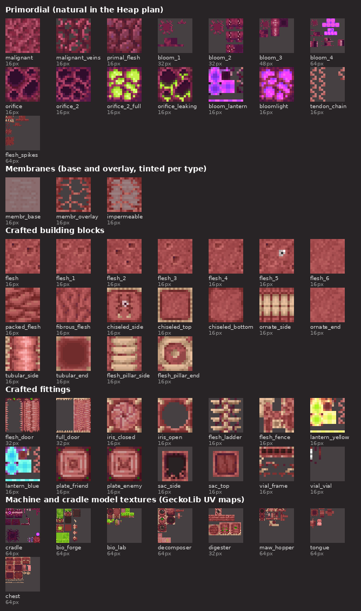

| Block | Textures |
|---|---|
| malignant_flesh, slab, stairs, wall | `malignant_flesh` |
| malignant_flesh_veins | `malignant_flesh_veins` |
| primal_flesh, slab, stairs, wall | `primal_flesh` |
| primal_bloom | `primal_bloom_1` to `_4` (one per age), `primal_flesh` |
| primal_orifice | `primal_orifice`, `primal_orifice_2`, `primal_orifice_2_full`, `primal_orifice_leaking`, `primal_flesh` |
| primordial_bio_lantern / bloomlight | `primordial_bio_lantern` / `bloomlight` |
| tendon_chain / flesh_spike | `tendon_chain` / `flesh_spikes`, `packed_flesh` |
| the 5 membranes | `membrane_base` + `membrane_overlay` (tinted per type); impermeable: `impermeable_membrane` |
| flesh, slab, stairs, wall | `flesh` and 6 random variants `flesh_1` to `flesh_6` |
| packed_flesh set, fibrous, chiseled, ornate, tubular, pillar | one texture each, or side + end (sheet) |
| doors, iris door, ladder, fence, gate, lanterns, pressure sensor, storage sac, vial holder | as named in the sheet |
| primordial_cradle, bio_forge, bio_lab, decomposer, digester, maw_hopper, tongue, fleshkin_chest | GeckoLib model + its own texture |

**Primordial Cradle** (offline render of its GeckoLib model, as for the mobs in 3.3):

**Mobs.** All five share one model (`geo/entity/flesh_blob.geo.json`, a cube with up to 7 optional tumors) and grow
by eating food items: size 1 to 10, scale 0.5 + 0.25 per size (0.75 to 3 blocks), health and damage scale with size.
None spawns naturally; the cradle and spawn eggs are the only sources. Renders: left without tumors (the primordial
blobs spawn that way), right with all seven (cradle blobs roll tumors from the tribute). Named blobs switch texture
(Easter eggs: "trololo", "krusty", "beholder").

| Mob | Render (no tumors, all tumors) | Texture | Category, base hp / damage per size | Behavior |
|---|---|---|---|---|
| Flesh Blob |  | `flesh_blob_neutral` | creature, 10 / 1 | eats food, grows |
| Hungry Flesh Blob |  | `flesh_blob_hostile` | creature (but `Enemy`), 10 / 2 | attacks |
| Legacy Flesh Blob |  | `flesh_blob_legacy` | creature, 10 / 1 | Biomancy 1 look |
| Primordial Flesh Blob | 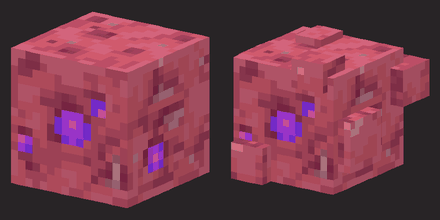 | `primordial_flesh_blob_neutral` | monster, 15 / 2 | carries tribute to cradles; **places malignant flesh where it dies** (not when burning or freezing) |
| Primordial Hungry Flesh Blob |  | `primordial_flesh_blob_hostile` | monster, 20 / 4 | attacks; same death placement |

Unused in the jar: `malignant_flesh_blob.geo.json` and its texture, and the Boomling model and class (no entity type
registered).

Effects: Corrosive Acid, Armor Shred, Fertility, Bleed, Essence Anemia (`[PH]`), Drowsy, Despoil. Enchantments: Despoil
(extra mob-part drops through the `despoil` loot modifier; needs the enchantment or effect, so it does nothing to
plain kills), Anesthetic Touch.

### 10.2 Spread paths

| # | Path | Code | Reaches outside a cradle? |
|---|---|---|---|
| M1 | Charged malignant veins grow, convert blocks under them (`#biomancy:flesh_replaceable`: dirt, sand, gravel, clay, snow, leaves, natural logs, flowers, moss, vines, melons, pumpkins, plus any replaceable block) and pass charge on | `FleshVeinsBlock.tick` | yes: veins charged by meat dropped on them spread with no cradle |
| M2 | Primal Bloom shoots Bloomberries up to 8 + 6 blocks away; they plant blooms or malignant flesh | `BloomBlock.randomTick`, `BloomberryProjectile` | yes: self-propagating |
| M3 | Primal Membrane fills mound chambers | `SpreadingMembraneBlock.tick` | no (needs a cradle's mound and energy) |
| M4 | Primordial blobs place malignant flesh or veins where they die | `PrimordialEaterFleshBlob.remove` | yes, wherever they die |
| M5 | Cradle sacrifice turns the block below into malignant flesh and seeds charged veins; its energy feeds M1 and M3 | `PrimordialCradleBlockEntity.onSacrifice` | the cradle can be placed anywhere |
| A1 | Acid fluid random-ticks: grass -> dirt, cobblestone -> gravel, stone, deepslate, blackstone and nether bricks -> cracked, copper ages; destroys leaves, moss, vines, flowers | `AcidFluid.randomTick` | yes, wherever acid flows; not flesh, but a world-changing effect |

### 10.3 Overlap

| Thing | Overlaps with | Problem | Proposal |
|---|---|---|---|
| Malignant, primal and crafted flesh blocks | BOP flesh and porous flesh, FTH flesh set | Three flesh families with three palettes in one biome (BOP brown-red, FTH dark red, Biomancy pink and magenta; sheets in 3.1 and 10.1) | *overlaps w/ BOP and FTH flesh* B2 |
| Acid fluid and bucket | Power Grid acid ([power_grid.md](power_grid.md), `#82` mixing recipes, acid from flesh in water) | Two acids; Biomancy's erodes blocks | *overlaps w/ Power Grid acid* B8 |
| Tendon Chain | BOP flesh tendons, FTH flesh roots | Three hanging or climbing flesh strands | keep; different shapes |
| Malignant veins | FTH flesh veins, vanilla sculk veins | Look only once ticks are off | none |
| Flesh Bits, mob parts, Bloomberry (foods) | rotten flesh, FTH Flesh, pack meats | More flesh foods | food values later (crafting deferred, B11) |
| Trades | butcher, cleric, wandering trader | Biomancy items sold everywhere | *overlaps w/ trades* B9 |
| Cat morning gift | vanilla cat gifts | Biomancy items gifted everywhere | B9 |
| Flesh blob eating food items | Item physics, hoppers | Blobs eat dropped food | none |

### 10.4 Upstream bugs

None found; the code was read for mechanics, not audited line by line. `[WIP]`, `[PH]` and `[Dev Tool]` items are
unfinished upstream content: hide them from JEI and creative (B10).

### 10.5 Fold-in, in build order

Same homes as FTH (section 4): Creative Worldgen for containment, worldgen and spawns; Creative Common for effects and
dicts; crafting content deferred.

1. **Install and dumps**: jar into `mods/` (skill `add-mod`), `mod_sides.md` row (both), `/dumpall`.
2. **Stop spread M1, M2, M4** (Creative Worldgen mixins, gated on Biomancy 2.3.2.0): veins never random-tick
   (`isRandomlyTicking` false, or charge forced to 0 on placement and in `entityInside`); bloom grows to ripe and
   stops (no Bloomberry shot; harvest stays); primordial blob death placement off, or Heap-only (B5).
3. **Cradle M3, M5** (B4): config `primalEnergySupplyOfCradle = NONE` (copy to `configs_edited/`), and the sacrifice's
   block conversion and vein seeding Heap-only or off by mixin. Blob spawning from tributes stays.
4. **Acid A1** (B8): random tick off, or the erosion map emptied; tie to the Power Grid acid decision.
5. **Tags** (`global.tags`): empty `#biomancy:flesh_replaceable` as a backup for M1; Biomancy blocks into BlockRunner
   surface tags; BOP flesh into `#biomancy:allow_veins_to_attach` if veins generate on it.
6. **Heap worldgen** (B2, B3): same pack folder and modifier as FTH step 5, gated on BOP and Biomancy. Candidates:
   malignant flesh and primal flesh patches, uncharged vein carpets, blooms, orifices on ceilings (acid drips, B8),
   tendon chains hanging from the ceiling, bloomlights, rare cradle nests (B3).
7. **Spawns** (B6): `forge:add_spawns` for the two primordial blobs in the Heap only; register spawn placements.
   Spawned blobs pick a size at spawn (check `finalizeSpawn`).
8. **Global content** (B9): config trades off; override the `cat_morning_gift` loot modifier with none. Despoil
   stays (gated by its own enchantment).
9. **Names, JEI** (B10): hide the `[WIP]`, `[PH]` and `[Dev Tool]` items and the 5 spawn eggs; fix names that keep a
   placeholder tag. Lang override in Creative Worldgen's `assets/biomancy/lang/`.
10. **Release**: changelog family `## Biomancy` once built, project page credit (MIT + CC BY-NC 4.0, B12).

Order: 2 to 4 before any world loads Biomancy; 6 and 7 after B2 to B6; crafting (recipes through `global.NCH`, food,
potions, item physics, stack sizes) is a later phase (B11).

### 10.6 Decisions for the owner

| # | Question | Recommendation | Default if not answered |
|---|---|---|---|
| B1 | Biomancy in the pack at all, given its crafting tree (machines, 351 recipes) is global by nature? | Yes: Heap world content now, crafting later | Yes |
| B2 | Which Biomancy blocks generate in the Heap, and how do three flesh palettes share it? | Primordial set only (malignant, primal, veins, blooms, orifices, tendon chains, bloomlights) in their own patches, apart from FTH patches | Malignant and primal patches, veins, tendon chains |
| B3 | Natural cradle "nests" in the Heap (a cradle on a small malignant mound)? | Yes, rare; players can still craft one | No |
| B4 | Cradle outside the Heap: block conversion and vein seeding off? | Off outside the Heap, on inside; primal energy `NONE` everywhere | Off everywhere, energy `NONE` |
| B5 | Primordial blob death placement (M4) | Heap only | Off |
| B6 | Natural spawns in the Heap | Primordial Hungry Flesh Blob 6, Primordial Flesh Blob 4 (sizes 1 to 3) | Primordial Hungry Flesh Blob 4 |
| B7 | Primal Bloom: ripe blooms stop (harvest only) or keep shooting inside the Heap? | Stop everywhere | Stop everywhere |
| B8 | Biomancy acid: erosion on or off; next to Power Grid acid, keep both fluids? | Erosion off; keep both fluids for now, merge later with the crafting phase | Erosion off |
| B9 | Trades and cat gifts with Biomancy items | Off (Heap-only goal) | Off |
| B10 | Hide `[WIP]`, `[PH]`, `[Dev Tool]` items and the spawn eggs | Yes | Yes |
| B11 | Crafting phase (machines, mob parts, serums, foods) | Later report pass through `global.NCH` and the food rules | Deferred |
| B12 | CC BY-NC 4.0 art: the pack is non-commercial and credits it | Credit on the project page | Credit only |

### 10.7 In-game tests (drafted)

- [ ] **FTH-17 Boot with Biomancy:** server and client with Biomancy, BOP and FTH -> no mixin errors; config shows
  `primalEnergySupplyOfCradle = NONE`, trades off.
- [ ] **FTH-18 Veins stay put:** in the Overworld place malignant veins on dirt and logs, drop 20 raw beef on them, wait
  10 minutes -> veins do not grow, dirt and logs unchanged.
- [ ] **FTH-19 Bloom:** place a Primal Bloom with air in front, `/gamerule randomTickSpeed 300`, 5 minutes -> it ripens,
  never shoots; right-click gives Bloomberries.
- [ ] **FTH-20 Cradle outside the Heap:** craft and fill a cradle in the Overworld -> a blob spawns (or spikes hit), the
  block below and around stays as it was (B4).
- [ ] **FTH-21 Cradle in the Heap:** same in the Heap -> per B4.
- [ ] **FTH-22 Primordial blob death:** kill a Primordial Flesh Blob in the Overworld and one in the Heap -> malignant
  flesh only per B5.
- [ ] **FTH-23 Acid:** pour Biomancy acid next to grass, cobblestone and stone bricks, 10 minutes at
  randomTickSpeed 300 -> per B8.
- [ ] **FTH-24 Heap features:** fly 500 blocks in the Heap -> Biomancy blocks per B2 and B3; none in other biomes.
- [ ] **FTH-25 Heap spawns:** 10 minutes in the Heap -> primordial blobs per B6; none elsewhere.
- [ ] **FTH-26 Client:** blobs render with tumors and sizes, the cradle animates, blooms show four stages, membranes
  tint by type; hidden items absent from JEI (B10).

## 11. History

- 2026-11-25: Biomancy 2 (2.3.2.0) added as section 10: blocks, mobs, spread paths, overlap, fold-in, B1 to B12, FTH-17 to
  FTH-26, block texture sheet and renders of the cradle and the five blobs; crafting content deferred (owner).

- 2026-11-25: block texture sheet, mob renders and size lineup added (section 3.1, 3.3; images in `flesh_that_hates/`).
- 2026-11-25: investigation written from `FleshThatHates-forge-1.19.2-1.0.1.jar` (decompiled beside the jar in
  `DecompiledMods/`), nothing built.
