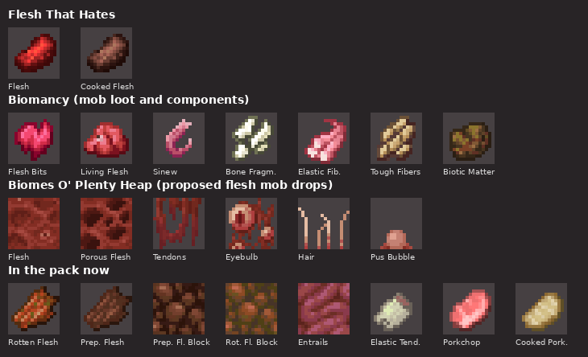
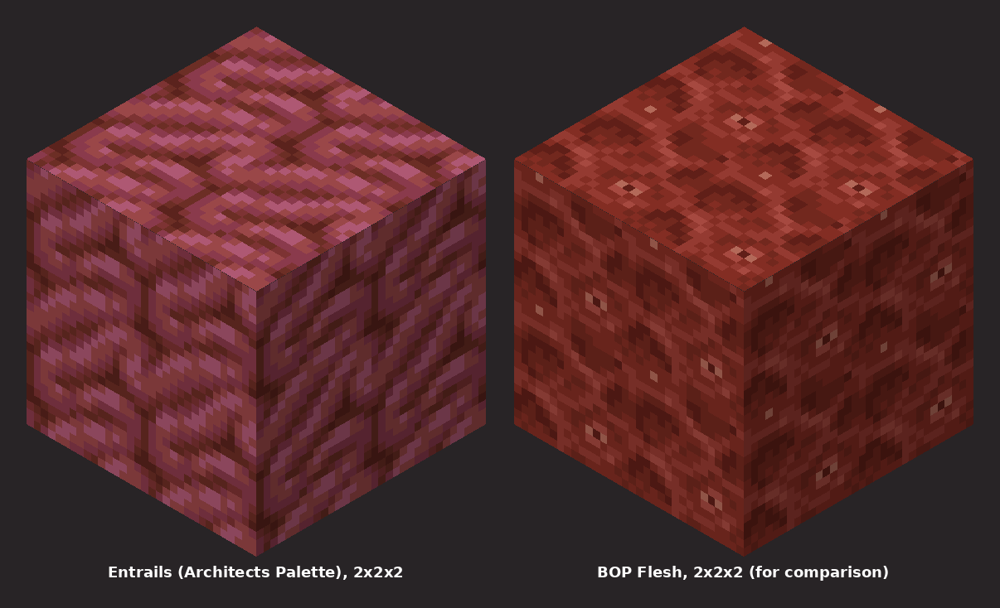

# Flesh That Hates in the Visceral Heap: integration plan (2026-11-25)

<!-- generated:status_index begin open_work sha1=963e45182fc0 -->
**Open work** (generated from `todo/rows/*.csv` by `tools/status_index.py`; change a row with `tools/todo.py`). Status: 7 open TODO rows (Planned 7), 0 Complete.

| Id | Status | Tests | Change |
|---|---|---|---|
| `mod-integration #30` | Planned | S C P | Flesh That Hates (1.0.1) in the Visceral Heap: flesh mobs only (no FTH blocks), incubator lifeforce system; Biomancy 2 (2.3.2.0) blocks and mobs |
| `mod-integration #38` | Planned | S C | Flesh That Hates P1: leave out every FTH block, the Bulwark, the Spawner, both effects, the potion and the Flesh Detector; no griefing, no /fill, no evolution, no incubator growth; flesh names without SCP; upstream bug fixes |
| `mod-integration #39` | Planned | S C | Flesh That Hates P2: flesh mob type, Smite against it, fire and lava x3, mobs avoid fire and lava, drops from loot tables (BOP Flesh and Porous Flesh) |
| `mod-integration #40` | Planned | S C | Flesh That Hates P3: conversions in the Visceral Heap (standing on flesh: pillagers, villagers, witches; killed by flesh mobs: humanoids, animals by size, players beside their corpse) with the red cloud and falling chunks |
| `mod-integration #41` | Planned | S C | Flesh That Hates P4: incubators hold lifeforce, claim chunks, take subs, spawn flesh mobs from flesh walls and floors for a cost, buff flesh mobs, promote a floating Big Incubator |
| `mod-integration #42` | Planned | S C | Flesh That Hates P5: natural flesh spawns in unclaimed Visceral Heap chunks, own solo-oriented pool (owner designs it) |
| `mod-integration #43` | Planned | S C | Flesh That Hates P6: drop review: final flesh mob loot, fate of FTH Flesh and Cooked Flesh |
<!-- generated:status_index end open_work -->

Owner notes of 2026-11-25 (chat) turned into a plan. Nothing built. Investigation and upstream facts:
[flesh_that_hates.md](flesh_that_hates.md) (the report; its section 3.3.1 has the per-mob numbers this plan changes).
TODO: `mod-integration #30` and `#38` to `#43` (section 9). Test prefix `FTH-` (this plan adds FTH-27 onward).
Code home: Creative Worldgen (the Heap's bundle, [visceral_heap.md](visceral_heap.md)), package `fleshheap/`;
the Flesh That Hates jar stays untouched (AFL 3.0), all changes are our mixins, data and config.

This plan replaces the report's decisions D1 to D16 where they differ (section 8). Biomancy (report section 10) is
not part of these notes; its decisions B1 to B12 stay open.

## 1. Intake (owner's words, split)

| # | Item (owner's words) | Class | Notes, premise checks |
|---|---|---|---|
| 1 | "add a custom 'flesh' type for all the flesh hates mobs" | clear | New `MobType` instance; every FTH entity's `getMobType()` (all return UNDEFINED today) returns it |
| 2 | "harming, poison, wither, healing, regen, and other effects that affect the player affect the flesh mobs the same way" | premise, true | Only `MobType.UNDEAD` inverts heal and harm and is immune to Poison and Regeneration; a new type behaves like a player by default. Nothing to build beyond not adding the type to any undead check |
| 3 | "smite does extra damage to flesh mobs" | clear | Smite's bonus checks `UNDEAD` only (`DamageEnchantment.getDamageBonus`); a mixin adds the flesh type at the same 2.5 per level |
| 4 | "the extra fire damage should be applied through this mob type" | open -> ruled | Upstream: 3 to 5 extra damage per tick while burning. Ruling R4: fire, burning and lava damage x3 for the flesh type |
| 5 | "flesh mob ai should avoid lava/fire over attacking the player/other mobs" | clear | Highest-priority avoid goal plus pathfinding malus for fire, lava and damage-fire nodes |
| 6 | "flesh mobs will only drop bop flesh items" | open -> pinned | R2: Flesh and Porous Flesh blocks only for now; amounts and extras pinned for a drop review |
| 7 | "none of the flesh that hate blocks are added, and therefore no mob is able to convert blocks" | clear | All 39 blocks (and their items) left out of the registries, as the Heap allowlist does for BOP. Supersedes D1 to D5, D11 |
| 8 | "flesh mobs only spawn in the flesh heap ontop of porus/flesh blocks" | clear | Spawn placement predicate: biome `biomesoplenty:visceral_heap`, block below in `#creativeworldgen:flesh_spawnable` (BOP flesh, porous flesh) |
| 9 | "the only flesh mobs to spawn should be humanoids (small chance), animal, pincher, snacher, small and big incubator (low chance), drifter, herpad, scuttler, cradle (low chance), stretcher (low chance)" | clear | Incubator spawn pool (section 5.6). Natural spawns: R5 |
| 10 | "humanoid pillagers standing on flesh in the flesh biome start to shake like a curing zombie villager and convert to infected pillagers after 10 seconds (configurable)" | clear | Section 4.1 |
| 11 | "villagers and witches convert to random infected humanoids the same way" | clear | Section 4.1 |
| 12 | "large animals turn into the infected animals, small animals turn into the pincher" | open -> ruled | R3: hitbox width 0.9 or more is large |
| 13 | "players killed should also turn to an infected humanoid with the standard corpse behavior" | clear | Corpse mod corpse as usual, plus a flesh humanoid at the death spot |
| 14 | "converting to a flesh mob should have a cloud of red particles over the mobs general size in large chunks fall to the ground" | clear | Section 4.3 |
| 15 | "flesh mobs dont grief blocks" | clear | Cancels the wood and glass removal (Bulwark, Herpad, Scuttler, Stretcher) and the Big Incubator's `/fill ... destroy` |
| 16 | "the humanoid 1-4 kill mechanic is not enabled" | clear | The fourth-kill evolution is off |
| 17 | "each humanoid model is equally likely to spawn when a infected humanoid is spawned" | clear | Variant 0 to 3 uniform on every spawn path |
| 18 | "remove bulwark" | clear | Not registered (entity, egg); out of every pool |
| 19 | "remove the scp610 spawner" | clear | Not registered |
| 20 | "remove flesh infection effect, infection/transformation only happens on death" | clear | Effect, potion and its 4 bottle forms not registered; every procedure that applies it canceled. Supersedes D10, D15 |
| 21 | "fix all the upstream bugs" | clear | Report B1 to B6; B1 (FTH recipes), B3 (block ticks) and B4 (log tags) go away with the blocks |
| 22 | "drop mentions of scp-610 or scp in player facing content" | clear | Names, death messages, egg names, JEI text. Supersedes D12 |
| 23 | "rename 'infected' to 'flesh' on mob names etc." | clear | Section 3.4 |
| 24 | "flesh mob conversion on death only happens if the death occured in the flesh heap" | open -> ruled | R1: and only when a flesh mob is the killer |
| 25 | "investiage flesh items for merging, give a texture preview and put it in the writeup" | clear | Section 7 and the report section 2 |
| 26 | "drop flesh detector" | clear | Not registered. Supersedes D14 |
| 27 | "move mob drops into loot tables" | clear | Entity loot tables `flesh_that_hates:entities/<id>`; procedure drops canceled. Supersedes D16 |
| 28 | "an incubator holds a 'tank' of 'lifeforce' that is refilled when mobs are killed (how unconvertable mobs are consumed)" | clear | Section 5 |
| 29 | "the incubator should claim the chunks in a 3x3 (configurable, default for small incubator)" | clear | 5.1 |
| 30 | "any further incubators should defer to the original incubator, and add 'LF' capacity up to 2 more sub-incubators (configurable, default for small, 5 small incubators for large incubator) with the rest not adding capacity" | clear | 5.2 |
| 31 | "incubators should stay where they are located when chunks are loaded and unloaded" | clear | Persistent; position saved |
| 32 | "large incubators, assuming they float, should spawn floating away from walls in a flesh biome and move slightly upon game load and unload, if no blocks are in the move path" | premise, false -> ruled | Upstream Big Incubator has gravity, speed 0, a 2.8 x 7 hitbox and stands on three legs. R6: it floats, legs dangle |
| 33 | "small incubators that evolve into a big incubator 'promote' a spawned big incubator and becomes the new incubators sub-tank" | clear | 5.8 |
| 34 | "incubators should use lifeforce to spawn new flesh mobs with spawns emerging from floors and walls of flesh where space permits, and normal mob spawning mechanics if unable" | clear | 5.5 |
| 35 | "each mob should have its own cost associated with spawning it" | clear | 5.6 |
| 36 | "incubators have a max spawned cap increased by subs" | clear | 5.3 |
| 37 | "incubators have a small passive lf gain also aided by subs" | clear | 5.3 |
| 38 | "main incubators provides configurable strength, regen, and resistance to flesh mobs configurable distance, differing for small/large main incubator" | clear | 5.7 |
| 39 | "main incubators should have particles showing it to be the main" | clear | 5.9: ring marker |
| 40 | "large floating incubators drip blood/chunk particles that a conversion drops" | clear | 5.9 |
| 41 | "give recommendations for the small incubator" | open -> ruled | R7: pulse and blood drips, on large incubators too |
| 42 | "incubators dont grow with time; instead, a main small incubator with enough stored life force, max subs spawned, and enough total lf spend can spawn and promote a large incubator" | clear | 5.8; the upstream 48000-tick growth is off |
| 43 | "deaths transfer lf to the incubator claimer of the death chunk, not the incubator that spawned the mob" | clear | 5.4 |
| 44 | "despawning flesh mobs should return life force to the incubators that they spawned from" | clear | 5.4 |
| 45 | "build out the port testing instance with the minimum modlist (plus all performance and qol/ui) needed to load the full unedited mods for the flesh that hates, and biomancy (plus my flesh biome nether changes, but these are edited) for eval" | clear | Done 2026-11-25, section 10 |

## 2. Owner rulings

| # | Item (owner's words) | Class | Ruling | Date | Source |
|---|---|---|---|---|---|
| R1 | "flesh mob conversion on death only happens if the death occured in the flesh heap" | open | Only a death whose killer is a flesh mob, inside the Heap; deaths while burning never convert. Other deaths in a claimed chunk give lifeforce | 2026-11-25 | AskUserQuestion 2026-11-25 |
| R2 | "flesh mobs will only drop bop flesh items" | open | Pinned for a drop review; for now BOP Flesh and Porous Flesh blocks only | 2026-11-25 | AskUserQuestion 2026-11-25 |
| R3 | "large animals ... small animals turn into the pincher" | open | Hitbox width 0.9 or more = large (cow, pig, sheep, goat, horse, llama, hoglin); smaller = Pincher (chicken, rabbit, cat, fox, wolf, parrot, frog); two override tags | 2026-11-25 | AskUserQuestion 2026-11-25 |
| R4 | "the extra fire damage should be applied through this mob type" | open | Fire, burning and lava damage x3 for the flesh type (config) | 2026-11-25 | AskUserQuestion 2026-11-25 |
| R5 | "flesh mobs only spawn in the flesh heap" (natural vs incubator spawning) | open | Natural spawns only in chunks no incubator claims, at a low chance, from their own skewed solo-oriented pool (built later); in claimed chunks only incubators spawn | 2026-11-25 | AskUserQuestion 2026-11-25 |
| R6 | "large incubators, assuming they float" | premise | Big Incubators float (no gravity), hover 1 to 3 blocks over the floor away from walls, legs dangle; up to 1 block nudge on chunk load and unload when the path is clear | 2026-11-25 | AskUserQuestion 2026-11-25 |
| R7 | "give recommendations for the small incubator" | open | Small: a red-dust pulse every ~2 s (heartbeat) and rare BOP dripping blood under it; large incubators get the same on top of their blood and chunk drips. Main marker: a slow ring of dark-red dust at mid height | 2026-11-25 | AskUserQuestion 2026-11-25 |
| R8 | FTH Flesh and Cooked Flesh (lose their only source under R2) | open | Pinned with the drop review | 2026-11-25 | AskUserQuestion 2026-11-25 |
| R9 | Which victims count as humanoid (was A1) | open | Player, villager, wandering trader, witch, pillager, plus zombies and their humanoid forms (zombie, husk, drowned, zombie villager) and piglins with theirs (piglin, piglin brute, zombified piglin). Zombified piglins are the Heap's main spawn (weight 100), so flesh-mob kills of them are expected to be the main flesh source | 2026-11-26 | chat 2026-11-26 |
| R10 | Standing conversion when the mob steps off flesh (was A2) | open | Leaving flesh (or the Heap) cancels the conversion; standing on flesh again starts a new 10 s | 2026-11-26 | chat 2026-11-26 |
| A3 | Lifeforce from flesh mob deaths | agent default, confirmed 2026-11-26 (chat) | A killed flesh mob gives 50 % of its spawn cost to the claimer of the chunk; a despawn returns 100 % to its own incubator |
| A4 | Every number in section 6 | agent default, owner evaluates (chat 2026-11-26) | Config values; first guesses to tune in the eval instance |
| A5 | How FTH content is removed | agent default, confirmed 2026-11-26 (chat) | Registry allowlist (the `HeapDeferredRegisterMixin` pattern): left-out ids are never registered, so they cannot appear in saves, JEI or commands. Each upstream procedure that names a left-out id is canceled first |

## 3. Flesh mobs

### 3.1 Roster

| Upstream id | New name | Kept | Notes |
|---|---|---|---|
| `infected_pillager` | Flesh Pillager | yes | Only from the standing conversion (4.1) and incubators; no Overworld spawn (report B2 gone) |
| `scp_6101` | Flesh Humanoid | yes | 4 models, uniform |
| `scp_6102` | Flesh Animal | yes | 2 models, uniform |
| `scp_6103` | Pincher | yes | |
| `scp_6104` | (Bulwark) | no | Not registered |
| `scp_6105` | Snatcher | yes | Pull kept; Call of the Hive on contact and on death kept only if the effect survives (3.3) |
| `small_scp_6106` | Small Incubator | yes | Section 5 |
| `big_scp_6106` | Big Incubator | yes | Floats (R6); no `/fill` on spawn |
| `scp_6107` | Drifter | yes | |
| `scp_6108` | Herpad | yes | Pincher summons come from its incubator's lifeforce (5.6), not free |
| `scp_6109` | Scuttler | yes | |
| `scp_61010` | Cradle | yes | Births come from its incubator's lifeforce (5.6), not free |
| `scp_61011` | Stretcher | yes | |
| `scp_610_spawner` | (Spawner) | no | Not registered |

### 3.2 Flesh mob type

- `FleshMobType.FLESH`, one `MobType` instance; a mixin on each kept entity class returns it from `getMobType()`.
- Tag `#creativeworldgen:flesh_mobs` lists the kept entity types, for other code (Smite, JEI text, spawns).
- Effects: no change needed (intake 2).
- Smite: `DamageEnchantment` type 1 (Smite) adds 2.5 per level against `FLESH` as it does against `UNDEAD`. Enchantment
  Descriptions text for Smite gets "and flesh mobs" through the lang override.
- Fire: a `LivingHurtEvent` handler multiplies damage by `fireMultiplier` (3.0) when the target is `FLESH` and the
  source is fire (`isFire()`: in fire, on fire, lava, hot floor, fireballs). Upstream's per-tick extra damage and the
  burning incubator explosion are canceled.
- AI: every kept mob gets an avoid-hazard goal at priority 0 (flee to the nearest node with no fire or lava within 2
  blocks when one is within 4) and path malus `DAMAGE_FIRE` 16, `DANGER_FIRE` 16, `LAVA` -1 so attack paths go around
  hazards. The Drifter (flying) gets the same malus.

### 3.3 Removed behavior

- Flesh Infection effect, potion (4 forms), every procedure that applies it (hits, raw Flesh, tooth bush, Snatcher).
- Call of the Hive (the effect that makes mobs gather): kept only if it is still applied by something kept; the
  Snatcher's contact and death rolls are the last users. Default: removed with the infection (one fewer effect), the
  Snatcher keeps its pull. Revisit in the eval.
- Fourth-kill evolution, Big Incubator `/fill` on first spawn, wood and glass removal on target pick, block conversion
  under incubators and Snatchers, incubator pack spawns (replaced by section 5), the 48000-tick growth.
- Procedure item drops (moved to loot tables, 3.5).

### 3.4 Names and text

- `lang/en_us.json` override in Creative Worldgen's pack resources: entity names (3.1), spawn eggs ("Flesh Humanoid Spawn
  Egg"), death messages (report B6 fixed: "<player> was torn apart by a Herpad"). No "SCP" or "610" in any player-facing
  string; ids stay (saves).
- Config keys and code may keep the upstream ids.

### 3.5 Drops

- Entity loot tables `data/flesh_that_hates/loot_tables/entities/<id>.json` in Creative Worldgen's data, pack loot
  rules ([loot.md](loot.md)): `killed_by_player`, Looting.
- R2 for now: BOP Flesh and Porous Flesh only. Starting counts keep upstream's spread on Flesh (Pincher 0-1 up to
  Big Incubator 0-6), Porous Flesh 0-1 on the large mobs and incubators. Pinned: the drop review sets the final table and
  decides FTH Flesh and Cooked Flesh (R8).
- XP unchanged (report 3.3.1).

## 4. Conversions

### 4.1 Standing conversion (living things on flesh)

- Who: Pillager -> Flesh Pillager; Villager, Witch, Wandering Trader -> Flesh Humanoid (random model). Zombies and piglins
  are not on this list (they convert only on death, 4.2).
- When: in the Heap, standing on BOP Flesh or Porous Flesh. Checked every 20 ticks.
- Then: a `converting` flag (synced) makes the mob shake like a curing zombie villager (client render mixin reads the
  flag), for `standConvertTicks` 200 (10 s, config). Stepping off flesh or leaving the Heap cancels it (R10);
  standing on flesh again restarts the full time. At 0: conversion (4.3).
- Lifeforce: none (the converted mob belongs to the claim's incubator for despawn refunds only if it later spawns
  from one; standing conversions are owned by no incubator).

### 4.2 Death conversion

- Only when the killer is a flesh mob and the victim dies inside the Heap (R1); never while the victim burns.
- Humanoids (R9: players, villagers, wandering traders, witches, zombies, husks, drowned, zombie villagers, piglins,
  piglin brutes, zombified piglins) -> Flesh Humanoid, random model; Pillager -> Flesh Pillager.
- Animals (`Animal` subclasses): hitbox width 0.9 or more -> Flesh Animal, random model; below -> Pincher (R3). Override
  tags `#creativeworldgen:flesh_converts/large` and `/small`.
- Players: the Corpse mod makes its corpse as usual (items, [plan_corpses.md](plan_corpses.md)); a Flesh Humanoid spawns
  at the death spot as well.
- Any other victim (and any death a conversion does not cover) gives lifeforce to the claimer of the chunk (5.4).

### 4.3 Conversion effect

- Server sends one packet; the client spawns, over the old mob's hitbox: red dust (count by hitbox volume, about 40 per
  cubic block, max 400) and BOP flesh item-break particles (`ItemParticleOption` of `biomesoplenty:flesh`) that fall
  with gravity, scaled 2x for "large chunks", plus a short flesh squelch (an existing sound, chosen in the build).
- The old mob is discarded and the new one placed at the same spot and rotation, with its custom name kept.

## 5. Incubators and lifeforce

### 5.1 Claims

- A main incubator claims a square of chunks centered on its own: radius 1 (3 x 3) for a small main, 2 (5 x 5) for a
  big main (config).
- Claims live in a `SavedData` on the Nether level: per incubator its UUID, position, size, LF, LF spent, subs, spawned
  mob UUIDs. Chunk -> claimer is a map built from it, so an unloaded incubator still owns its chunks.
- Claims never overlap. An incubator that appears inside a claimed chunk becomes a sub of that claimer (5.2), whatever
  its size; a big incubator placed by a command or egg inside a small main's claim also defers.

### 5.2 Subs

- A sub belongs to the main that claims its chunk. Up to `maxCapacitySubs` subs add capacity (small main 2, big main 5);
  further subs exist but add nothing.
- A sub that dies is removed from the main's list. When the main dies, the oldest sub becomes the new main (its own
  size's claim), and the rest re-defer to it, or become mains where its claim does not cover them.

### 5.3 Tank, gain, cap

| Value | Small main | Big main | Per sub (counted subs only) |
|---|---|---|---|
| Capacity (LF) | 200 | 1000 | +100 (small sub), +200 (big sub) |
| Passive gain (LF per minute, only while the main's chunk is loaded) | 2 | 6 | +1 |
| Spawned cap (alive mobs it spawned) | 4 | 10 | +2 |

### 5.4 Lifeforce in and out

- In: a non-converting death inside a claimed chunk adds the victim's max health x `lfPerHealth` (1.0) to the claimer,
  whoever spawned the victim. A killed flesh mob adds 50 % of its spawn cost (A3). Item, XP and player deaths count the
  same way (players: 20 at default health) unless they converted.
- Out: spawning (5.6) and promotion (5.8).
- Refund: a flesh mob that despawns returns 100 % of its cost to the incubator that spawned it, if that incubator is
  alive. Incubators themselves never despawn.
- LF is capped at capacity; overflow is lost.

### 5.5 Spawning

- Every `spawnInterval` 200 ticks, a main (or a sub, drawing on the main's tank) tries one spawn when: LF >= the
  picked mob's cost, alive spawned count < cap, a player within 64 blocks.
- Placement, first try: a random BOP Flesh or Porous Flesh face (floor or wall) within the claim, near the incubator
  (16 blocks), with room for the mob on the open side; the mob emerges: it starts inside the face, moves out over 20
  ticks with flesh particles, takes no damage while emerging.
- Fallback: vanilla placement rules (`NaturalSpawner.isValidSpawnPostitionForType` and the mob's spawn rules) on flesh
  floor in the claim.
- In claimed chunks no natural flesh spawn happens (R5).

### 5.6 Spawn pool and costs

| Mob | Weight | Cost (LF) | Notes |
|---|---|---|---|
| Pincher | 20 | 10 | Also the Herpad's summon (paid from the claim's tank) |
| Drifter | 14 | 15 | Flying: emerges from walls and ceiling too |
| Flesh Animal | 16 | 20 | |
| Flesh Humanoid | 6 (small chance) | 25 | Random model |
| Snatcher | 10 | 30 | |
| Scuttler | 10 | 40 | |
| Herpad | 8 | 80 | |
| Stretcher | 3 (low) | 60 | |
| Cradle | 3 (low) | 100 | Births paid from the claim's tank: each birth costs that mob's cost |
| Small Incubator | 2 (low) | 150 | Spawns as a sub of this main |
| Big Incubator | 1 (low) | 600 | Spawns as a sub; floats (5.10); a big main's pool only. Small mains get big ones only by promotion (5.8) |

### 5.7 Buffs from a main

| | Small main | Big main |
|---|---|---|
| Radius (blocks) | 16 | 32 |
| Strength | I | II |
| Regeneration | I | I |
| Resistance | none | I |

Applied every 40 ticks for 60 ticks to flesh mobs in range (ambient, no particles); all config. Upstream's Strength II at
50 blocks and the screen shake are replaced.

### 5.8 Promotion

- A small main that has LF >= 90 % of capacity, `maxCapacitySubs` subs, and LF spent in total >= `promoteSpent` (2000)
  spends `promoteCost` (500) and spawns a Big Incubator floating in open space within its claim (5.10).
- The big one becomes the main (claim grows to 5 x 5, its tank starts with the small main's remaining LF); the old main
  becomes its sub, and the old subs become the big main's subs.
- No growth with time.

### 5.9 Particles

| Who | Look |
|---|---|
| Every incubator | Red-dust pulse every ~2 s at the sac (heartbeat); rare BOP `dripping_blood` under it (R7) |
| Big incubators, in addition | Steady BOP blood drips and falling flesh chunks (the conversion's item particles, 4.3) under the mass |
| Mains, in addition | A slow ring of dark-red dust circling at mid height (R7) |

### 5.10 Big Incubator floating

- No gravity, `noPhysics` false (blocks still collide), no knockback (upstream 1000 resistance kept).
- Placement: open column over flesh floor, mass 1 to 3 blocks above the floor, 3 blocks of air from any wall on the
  sides; the legs hang (R6).
- On chunk load and unload: a random nudge of up to 1 block (any direction), only if the moved hitbox is free.

### 5.11 Persistence

- Incubators are persistent (`setPersistenceRequired`), saved with their UUID; the `SavedData` keeps position, claims and
  tank while the chunk is unloaded.

## 6. Config (`creativeworldgen-common.toml`, `[fleshHeap]`)

Every number in sections 3.2, 4 and 5 is a config value with the default given there (A4): `fireMultiplier`,
`standConvertTicks`, `largeAnimalWidth`, claim radius, capacity, gain, cap, subs, per-sub adds, `lfPerHealth`,
flesh-death share, spawn interval and range, weights and costs, buff radius and levels, promotion thresholds.
`configs_edited/` copy once the owner tunes it.

## 7. Flesh items (merge study)

| Item | Source now | Use | Merge proposal |
|---|---|---|---|
| FTH Flesh (food 1 / 0.1, infects) | FTH mob drops only | Food | R8 pinned: no source once drops are BOP-only; candidates: drop it, or a raw food butchered from BOP Flesh |
| FTH Cooked Flesh (6 / 0.4) | smelting FTH Flesh | Food | R8 pinned with it |
| FTH Flesh Detector | crafted | Finds SCP mobs | Dropped (intake 26) |
| BOP Flesh, Porous Flesh (blocks) | Heap ground | Crush and blood recipes ([plan_flesh_recipes.md](plan_flesh_recipes.md)) | The flesh mob drops (R2) |
| BOP Flesh Tendons, Eyebulb, Hair, Pus Bubble | Heap features | Crush pools | Candidates for the drop review |
| Biomancy Flesh Bits, Living Flesh, Sinew, Bone Fragments, Elastic and Tough Fibers, Biotic Matter | Biomancy mob loot and decomposing | Biomancy crafting | Outside these notes (report section 10); Flesh Bits is the nearest twin of FTH Flesh |
| Rotten Flesh | zombies | Food, Prepared Flesh | none |
| Prepared Flesh (`jrftl:`), Prepared Flesh Block | crafted from Rotten Flesh | Leather line | none |
| Rotten Flesh Block, Entrails (Architects Palette) | crafted; Entrails only by Architects Palette "warping" (a Rotten Flesh Block through a Nether portal) | Building (7.1) | Entrails is the look-alike of BOP Flesh; none |
| Elastic Tendon (Alex's Mobs) | Murmur drop only (underground caves, 0-2, Looting +1) | Tendon Whip (7.1) | Look-alike of BOP Flesh Tendons; none |

No item merge is proposed until the drop review: the only real duplicate is FTH Flesh against Biomancy Flesh Bits, and
both may leave.

### 7.1 Entrails and Elastic Tendon

| Item | How it is made | What uses it | Other behavior |
|---|---|---|---|
| Rotten Flesh Block (Architects Palette) | 9 Rotten Flesh, shapeless | Warping into Entrails | BlockRunner spongy tier |
| Entrails (Architects Palette, block) | Only warping: a Rotten Flesh Block thrown into a Nether portal (`architects_palette:warping`, Nether as target) | Its own building set: Entrails Slab (3 -> 6), Stairs (6 -> 4), Vertical Slab (3 slabs -> 3, back to a slab); no other recipe, no loot | Drips (vanilla dripping-water particles) from its bottom face when the block below is open; BlockRunner spongy tier; Item Physic `produce` family |
| Elastic Tendon (Alex's Mobs) | Murmur drop only, 0 to 2, Looting +1; no recipe | Tendon Whip only (2 Elastic Tendon, 3 Dropbear Claw, 1 wooden rod); no other recipe, trade or loot use | Animated item texture; Item Physic `organic` family |

Neither is used by any pack script or recipe of ours. Entrails is a decoration end-product; Elastic Tendon is a single-use
ingredient.

## 8. What this changes in the report

| Report decision | Now |
|---|---|
| D1 to D5, D11 (blocks, generation, spread) | No FTH blocks at all (intake 7) |
| D6 (natural spawns) | R5: unclaimed chunks only, own pool (later); incubators otherwise |
| D7 (conversions S5 to S7) | R1: flesh-mob kills in the Heap; S6 (infection death) and S7 (incubator hatching) gone |
| D8 (mobs leaving the Heap) | Unchanged: allowed, they convert nothing outside |
| D9 (Infected Pillager) | No natural spawn; standing conversion only (4.1) |
| D10, D15 (infection, potion) | Removed |
| D12 (SCP names) | Removed from player text |
| D13 (Flesh values) | Pinned (R8) |
| D14 (Flesh Detector) | Removed |
| D16 (loot tables) | Now, BOP items (3.5) |

## 9. Work rows and order

| Phase | Work | Row |
|---|---|---|
| P0 | Eval instance: owner plays the unedited mods (section 10) | `mod-integration #30` log |
| P1 | Registry allowlist and procedure cancels: blocks, Bulwark, Spawner, effects, potion, detector out; no griefing, no `/fill`, no evolution, no growth; names and lang; upstream bug fixes | `mod-integration #38` |
| P2 | Flesh mob type, Smite, fire x3, hazard AI, loot tables (R2 interim) | `mod-integration #39` |
| P3 | Conversions: standing (4.1), death (4.2), effect (4.3) | `mod-integration #40` |
| P4 | Incubators: claims, subs, tank, spawning and emergence, buffs, promotion, floating, particles | `mod-integration #41` |
| P5 | Natural spawns in unclaimed chunks: own skewed solo pool (R5, owner designs later) | `mod-integration #42` |
| P6 | Drop review: final tables, FTH Flesh and Cooked Flesh (R2, R8) | `mod-integration #43` |

Order: P1 before everything (removed ids crash procedures that still run); P2 before P3 (conversions need the type
tag); P4 after P3 (deaths feed tanks). Each phase adds its scratch rows to `rows/FTH.qb` when built.

## 10. Eval instance (CEPortTesting, set up 2026-11-25)

The ATLauncher instance `CEPortTesting` (Forge 43.3.9) now loads the unedited Flesh That Hates 1.0.1 and Biomancy
2.3.2.0 jars with the pack's Heap (Creative Worldgen with BOP and its containment):

- 75 jars in its `mods/`, every mandatory dependency present (static check of each `mods.toml`). Not booted yet.
- The minimum set: FTH, Biomancy, GeckoLib 3.1.40, BOP 17.1.2.544, Creative Worldgen (nests the TerraBlender stub)
  with what it requires: Creative Common, Compat and Loot, KubeJS, Rhino, Architectury, LootJS, and the 17 world
  generation mods Creative Worldgen marks as required (Terralith, Nullscape, Tectonic, the YUNG's set and its API,
  Towns and Towers, Philip's Ruins, Moog's End Structures, Hopo's ruins, Volcanic Caverns, Villages and Pillages,
  Geophilic Reforged).
- Performance: ModernFix, FerriteCore, MemoryLeakFix, EntityCulling, ImmediatelyFast, Rubidium and Rubidium Extra,
  Clumps, Packet Fixer, Debugify, FastFurnace and FastWorkbench, Async Locator.
- QoL and UI: JEI, JEED, Just Enough Resources and Breeding, WTHIT and Harvestability, AppleSkin, Controlling, Mouse
  Tweaks, Durability Tooltip, Mod Name Tooltip, Legendary Tooltips, Enchantment Descriptions, Highlighter, Xaero's
  Minimap, World Map and Zoomout, BetterF3, Better Third Person, Clear Void, Lava Clear View, Spyglass Improvements,
  Cherished Worlds, Detail Armor Bar, Chunky; with their libraries (Bookshelf, Placebo, Iceberg, Prism, Cloth Config,
  Bad Packets, SuperMartijn642's Config Library).
- Configs from the pack: `creativeworldgen-common.toml`, `modernfix-mixins.properties`, `debugify.json`, and
  `kubejs/generation_scripts/worldgen/` (the biome layout the Heap's share needs). The instance's old copies and its
  stale `creativecommon-1.2.0.jar` are in `CEPortTesting/disabledmods/fth_eval_parked/`.
- Creative Worldgen requires the 17 world generation mods (owner rule), so they cannot be left out while the Heap is.
- Eval tips: `/locate biome biomesoplenty:visceral_heap` in the Nether; FTH mobs need `/summon` or eggs (upstream spawns
  only the Pillager naturally); `/gamerule enableFleshGrow false` shows the Heap without spread.

## 11. Tests (drafted, run once built)

- [ ] **FTH-27 Flesh type:** `/summon` each kept mob, `/data get entity` via a probe of `getMobType()` -> flesh for all 12
- [ ] **FTH-28 Effects:** splash Harming, Healing, Poison, Regeneration, Wither on a Scuttler -> Harming hurts, Healing heals, Poison and Wither damage, Regeneration heals (as on a player)
- [ ] **FTH-29 Smite:** Smite V iron sword against a Scuttler -> 12.5 more damage than an unenchanted one
- [ ] **FTH-30 Fire x3:** Herpad in fire, damage per hit logged -> 3x the vanilla fire damage, no extra per-tick damage, a burning incubator does not explode
- [ ] **FTH-31 Hazard AI:** Pincher with a player behind a lava strip -> walks around or stops, never enters lava
- [ ] **FTH-32 Removed content:** registry dump -> no FTH block, no Bulwark, no Spawner, no Flesh Infection, Call of the Hive, potion or Flesh Detector; JEI shows none
- [ ] **FTH-33 Names:** every FTH name, egg and death message -> no "SCP", "610" or "Infected"
- [ ] **FTH-34 No griefing:** Herpad, Scuttler, Stretcher target a player behind oak and glass for 5 minutes; Big Incubator egg in a 3-high room -> no block removed
- [ ] **FTH-35 Standing conversion:** villager, witch, pillager on BOP Flesh in the Heap -> shake, convert after 10 s with the red cloud and falling chunks; on netherrack -> nothing; pushed off flesh at 5 s -> shaking stops, no conversion; back on flesh -> a new full 10 s
- [ ] **FTH-36 Death conversion:** Pincher kills a villager, a zombified piglin, a husk, a cow, a chicken in the Heap -> Flesh Humanoid (x3), Flesh Animal, Pincher; same kills outside the Heap or by a player -> no conversion
- [ ] **FTH-37 Player death:** a flesh mob kills a player in the Heap -> Corpse mod corpse with the items and a Flesh Humanoid beside it
- [ ] **FTH-38 Humanoid models:** 400 Flesh Humanoids from eggs -> each of the 4 models near 25 %
- [ ] **FTH-39 Claims and subs:** small incubator, then 4 more in its 3 x 3 -> one main, 2 counted subs, 2 uncounted; capacity 400
- [ ] **FTH-40 Persistence:** incubators in unloaded chunks, server restart -> same positions, same tank, same claims
- [ ] **FTH-41 Lifeforce:** kill a zombified piglin and a flesh mob in a claimed chunk spawned by another incubator -> the claimer gains 20 and half the flesh mob's cost; a despawned flesh mob refunds its spawner
- [ ] **FTH-42 Spawning:** a main with LF waits -> mobs emerge from flesh floor and walls within the claim, never above the cap, each spawn debits its cost
- [ ] **FTH-43 Buffs:** flesh mob 10 and 20 blocks from a small main -> Strength I and Regeneration I at 10, nothing at 20
- [ ] **FTH-44 Promotion:** small main at full tank, 2 subs, 2000 spent -> a floating Big Incubator appears, becomes main, the small one its sub, claim 5 x 5
- [ ] **FTH-45 Floating:** Big Incubator spawn -> hovers 1 to 3 blocks up, 3 blocks from walls; repeated chunk unloads -> moves at most 1 block per load, never into blocks
- [ ] **FTH-46 Particles:** main and sub incubators of both sizes -> pulse and drips on all, chunk drips on big ones, the ring only on mains
- [ ] **FTH-47 Natural spawns:** claimed chunk vs unclaimed chunk over 20 minutes -> no natural flesh spawn in the claimed one
- [ ] **FTH-48 Loot:** kill each mob with Looting III -> only BOP Flesh and Porous Flesh, counts in the loot table's range

## 12. History

- 2026-11-26: R9 (zombies and piglins on the humanoid list), R10 (leaving flesh cancels the standing conversion); A3,
  A5 confirmed, A4 to the eval; section 7.1 (Entrails and Elastic Tendon uses, 2x2x2 render).
- 2026-11-25: owner notes taken in (45 items, rulings R1 to R8 by AskUserQuestion, agent defaults A1 to A5); eval instance
  CEPortTesting set up (section 10); flesh item sheet (section 7). Nothing built.
